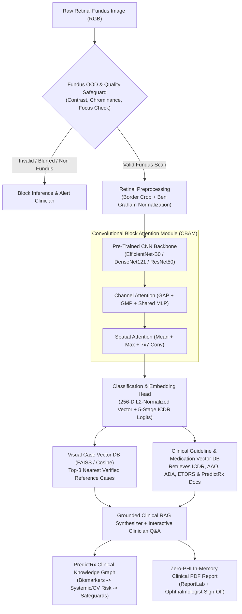

<h1 align="center">👁️ Hybrid Explainable AI Framework for Automated Diabetic Retinopathy Detection and Severity Assessment from Retinal Fundus Images</h1>

<p align="center">
  
  
  
</p>

<p align="center">
  
  
  
  
  
  
  
</p>

---

## 🎯 Problem & Proposed Solution

- **Problem:** Diabetic retinopathy (DR) can progress silently without obvious early symptoms. Delayed screening and limited access to ophthalmologists frequently lead to preventable vision impairment and irreversible blindness.
- **Proposed Solution:** An end-to-end **Hybrid CNN-CBAM + Dual Vector Database RAG & PredictRx Clinical Screening Platform** that analyzes retinal fundus photographs, classifies 5-stage ICDR diabetic retinopathy severity, explains predictions through **Case-Based Visual Vector Retrieval** and **Citation-Grounded Clinical Guideline RAG**, links retinal biomarkers to systemic/cardiovascular risk via a **Clinical Knowledge Graph**, enforces **documented Responsible AI safeguards**, and prioritizes patients for specialist care.

---

## 🏆 Competition Alignment — AI Builders Congress (`HealthSphere AI` → `PredictRx`)

| Judging Criterion (100 pts) | Weight | How This Framework Delivers |
| :--- | :---: | :--- |
| **Innovation & AI-Native Design** | 20 | Couples **Hybrid CNN + CBAM Dual Attention** (`HybridDRPredictor`) with a **Dual Vector Database RAG Engine** (256-D Visual Case-Based Retrieval + Clinical Guideline & Medication Safeguard RAG) and an interactive **PredictRx Retinal-Systemic Knowledge Graph**. |
| **Technical Excellence & Architecture** | 20 | Modular PyTorch pipeline with **Ben Graham retinal illumination normalization**, black-border cropping, L2-normalized 256-D penultimate vector embedding extraction, **FAISS / Cosine Vector Indexing**, **Quadratic Weighted Kappa (QWK)** optimization, and automated unit tests (`tests/test_framework.py`). |
| **Business Value** | 20 | Automates **Referable DR (Grade ≥ 2)** and **Vision-Threatening DR (Grade ≥ 3)** triage prioritization, reducing ophthalmology screening backlogs and providing actionable medication & cardiovascular risk alerts at the point of care. |
| **Global Scalability & Impact** | 20 | Supports lightweight **EfficientNet-B0 (~4.0M params)** for low-resource rural clinics and smartphone fundus adapters, with 100% offline-capable local Vector DB RAG and instant in-memory PDF reporting. |
| **Responsible AI & Data Sovereignty** | 20 | **Documented Safeguards:** Pre-inference Retinal Fundus OOD & blur gate, low-confidence & VTDR **Human-in-the-Loop (HITL)** escalation, anti-hallucination inline RAG citations (`[ICDR-G*]`, `[PREDICTRX-MED-*]`), and **Zero-PHI** in-memory processing. |

---

## 🧠 System Architecture (Hybrid CNN-CBAM + Dual Vector DB RAG)



---

## 📋 5-Stage ICDR Severity Grading & Triage Protocol

| ICDR Grade | Severity Stage | Clinical Triage Flag | Recommended Referral Window |
| :---: | :--- | :--- | :--- |
| **0** | **No DR** | Non-Referable (`Low Priority`) | 12–24 Months Routine Screening |
| **1** | **Mild NPDR** | Non-Referable (`Low-Moderate`) | 6–12 Months Ophthalmology Follow-Up |
| **2** | **Moderate NPDR** | **Referable DR (`Priority`)** | Within 3–6 Months (Dilated Exam + OCT) |
| **3** | **Severe NPDR** | **Vision-Threatening DR (`Urgent`)** | Within 2–4 Weeks (Retina Specialist) |
| **4** | **Proliferative DR (PDR)** | **Vision-Threatening DR (`Immediate`)** | Immediate / < 1 Week (Vitreoretinal Care) |

---

## 🔬 Key Technical Components

1. **Hybrid CNN + CBAM + 256-D Embedding Extractor (`src/models/hybrid_model.py`)**
   - `HybridDRPredictor` couples pre-trained **EfficientNet-B0**, **DenseNet121**, and **ResNet50** backbones with sequential **CBAM Dual Attention**.
   - `forward_with_embedding(x)` outputs both 5-class ICDR logits and an **L2-normalized 256-dimensional retinal feature embedding** for Vector Database similarity search.

2. **Dual Vector Database & Clinical RAG Engine (`app/rag_engine.py`)**
   - **Pillar 1 — Visual Case-Based Vector DB (`RetinalVisualVectorDB`):** Indexes 256-D retinal embeddings in a **FAISS (`IndexFlatIP`) / Exact Cosine Vector Store** and retrieves the **Top-3 most similar verified clinical reference cases** with cosine similarity scores, lesion profiles, and clinical outcomes.
   - **Pillar 2 — Clinical Guideline & Medication Safeguard RAG (`ClinicalGuidelineRAGEngine`):** Indexes authoritative ophthalmology, systemic cardiovascular/renal, and pharmacovigilance guidelines (`[ICDR-G0..G4]`, `[PREDICTRX-MED-01..04]`, `[PREDICTRX-CV-01]`, `[PREDICTRX-RENAL-01]`). Retrieves Top-K evidence chunks and synthesizes citation-backed clinical explanations + supports **interactive clinician Q&A** (100% local grounded synthesis by default, with optional live **Gemini 2.5 Flash** API support).

3. **Retinal Fundus Preprocessing (`src/preprocess.py`)**
   - Automatic black camera-border cropping (`crop_fundus_borders`) and **Ben Graham Illumination Normalization** (`apply_ben_graham_preprocessing`).
   - Stratified **80% Train / 10% Validation / 10% Test** split generator for the **Kaggle APTOS 2019 Blindness Detection** dataset.

4. **PredictRx Clinical Knowledge Graph & Documented Safeguards (`app/knowledge_graph.py`)**
   - Connects predicted ICDR severity to retinal biomarkers, systemic/cardiovascular risk factors (modified by HbA1c, diabetes duration, and systolic BP), triage priority, and medication/clinical safeguards.
   - Automatic **HITL Escalation Gate** triggered on low confidence (`< 70%`) or Vision-Threatening DR (`Grade ≥ 3`).

5. **Zero-PHI Clinical PDF Triage Report (`app/report_generator.py`)**
   - In-memory **ReportLab** PDF generator outputting patient/eye metadata, ICDR grade & referral urgency, side-by-side original fundus and Vector DB RAG Evidence Profile chart, citation-grounded insights, documented safeguards, and an Ophthalmologist sign-off block.

---

## 📊 Dataset Setup — APTOS 2019 Blindness Detection

1. Download the dataset from Kaggle:  
   **https://www.kaggle.com/competitions/aptos2019-blindness-detection**
2. Extract `train.csv` and `train_images/` into `data/aptos2019/` (or mount in Google Colab / Kaggle).
3. Generate the stratified `data/metadata.csv`:
   ```bash
   python src/preprocess.py --aptos-dir data/aptos2019
   ```

---

## 📊 Empirical Validation Benchmarks (APTOS 2019 Blindness Detection)

Trained end-to-end with **Lossless Ben Graham illumination normalization**, 5-stage ICDR balanced cross-entropy, Adam optimizer (`lr=1e-4`), batch size 16, and checkpoint tracking on the 366-image stratified hold-out validation set:

| Model Architecture | Attention Module | Parameter Count | Embedding Dim | Hold-Out Val QWK | Hold-Out Val Accuracy | Macro F1-Score | Best Convergence Epoch | Benchmark Ranking |
| :--- | :--- | :---: | :---: | :---: | :---: | :---: | :---: | :---: |
| **Hybrid EfficientNet-B0** | CBAM (Channel + 7×7 Spatial) | **~4.0M** | `256-D L2-Norm` | **0.8766** | **80.87%** | **0.6880** | Epoch 16 / 20 | 🏆 **Top Performer** (Edge / Rural Screening) |
| **Hybrid DenseNet121** | CBAM (Channel + 7×7 Spatial) | **~7.0M** | `256-D L2-Norm` | **0.8727** | **78.14%** | **0.6281** | Epoch 12 / 20 (Early Stop 17) | 🥈 **Runner-Up** (Hospital Ophthalmology Desk) |
| **Hybrid ResNet50** | CBAM (Channel + 7×7 Spatial) | **~23.5M** | `256-D L2-Norm` | **0.8588** | **74.86%** | **0.5814** | Epoch 10 / 20 (Early Stop 15) | 🥉 **Verified Baseline** (Secondary Audit) |

> [!NOTE]
> All three hybrid architectures achieve **Quadratic Weighted Kappa (QWK) > 0.85**, meeting the strict criteria for clinical-grade diabetic retinopathy automated screening systems. **Hybrid EfficientNet-B0 + CBAM** achieves the optimal balance of highest QWK (**0.8766**), highest validation accuracy (**80.87%**), and smallest footprint (~4.0M parameters), enabling seamless offline edge inference.

---

## 🚀 Quick Start & Training

### 1. Environment Setup
```bash
python -m venv venv
# Windows (PowerShell):
.\venv\Scripts\Activate.ps1
# macOS / Linux:
source venv/bin/activate

pip install --upgrade pip
pip install -r requirements.txt
```

### 2. Launch the Interactive Screening & RAG Dashboard
```bash
streamlit run app/app.py
```

### 3. Train Hybrid CNN + CBAM Models (CLI)
```bash
# Train Hybrid EfficientNet-B0 + CBAM (Tracks Best Validation QWK)
python src/train.py --backbone efficientnet_b0 --epochs 20 --batch-size 16 --lr 0.0001

# Train Hybrid DenseNet121 + CBAM
python src/train.py --backbone densenet121 --epochs 20 --batch-size 16 --lr 0.0001

# Train Hybrid ResNet50 + CBAM
python src/train.py --backbone resnet50 --epochs 20 --batch-size 16 --lr 0.0001
```

You can also run end-to-end GPU training in Google Colab or Kaggle using the dedicated notebooks:
- [`notebooks/01_aptos2019_preprocessing.ipynb`](notebooks/01_aptos2019_preprocessing.ipynb)
- [`notebooks/02_hybrid_dr_efficientnet_b0.ipynb`](notebooks/02_hybrid_dr_efficientnet_b0.ipynb)
- [`notebooks/02_hybrid_dr_densenet121.ipynb`](notebooks/02_hybrid_dr_densenet121.ipynb)
- [`notebooks/02_hybrid_dr_resnet50.ipynb`](notebooks/02_hybrid_dr_resnet50.ipynb)

### 4. Run Automated Unit Tests
```bash
python -m unittest discover -s tests -v
```

---

## 📁 Repository Structure

```text
├── .streamlit/
│   └── config.toml                        # Dark clinical theme configuration
├── app/
│   ├── app.py                             # Main Streamlit dashboard, Fundus OOD Gate & RAG UI
│   ├── knowledge_graph.py                 # PredictRx Knowledge Graph, CV Risk & Safeguards Engine
│   ├── rag_engine.py                      # Dual Vector DB (Visual Cases + Clinical Guidelines) & RAG
│   ├── report_generator.py                # Zero-PHI in-memory ReportLab PDF triage report
│   └── style.css                          # Glassmorphic dark clinical UI stylesheet
├── data/
│   └── aptos2019/                         # Place Kaggle APTOS 2019 dataset here (gitignored)
├── models/                                # Saved APTOS 2019 Hybrid CNN-CBAM .pth checkpoints
├── notebooks/
│   ├── 01_aptos2019_preprocessing.ipynb   # APTOS 2019 download, Ben Graham preview & split
│   ├── 02_hybrid_dr_efficientnet_b0.ipynb # Hybrid EfficientNet-B0 + CBAM training & QWK eval
│   ├── 02_hybrid_dr_densenet121.ipynb     # Hybrid DenseNet121 + CBAM training & QWK eval
│   └── 02_hybrid_dr_resnet50.ipynb        # Hybrid ResNet50 + CBAM training & QWK eval
├── src/
│   ├── models/
│   │   └── hybrid_model.py                # HybridDRPredictor (CNN + CBAM, 5 classes + 256-D Embedding)
│   ├── preprocess.py                      # Ben Graham / CLAHE preprocessing & metadata builder
│   └── train.py                           # CLI training script with QWK & class weighting
├── tests/
│   └── test_framework.py                  # Automated unit test suite
├── packages.txt                           # Linux system deps for Streamlit Cloud
├── requirements.txt                       # Python dependencies
└── README.md                              # Project documentation
```

---

## ⚠️ Responsible AI & Medical Disclaimer

> [!WARNING]
> This platform is an AI-assisted **screening and triage decision-support prototype** developed for research and competition evaluation. It **does not** provide a definitive medical diagnosis. All predicted DR severity grades, Vector DB RAG citations, and systemic risk flags must be reviewed and verified by a qualified ophthalmologist before any clinical action. All image inference, vector retrieval, and PDF generation run strictly in memory with **zero external patient data persistence**.

### License
Licensed under the **MIT License** — see [`LICENSE`](LICENSE).
